# 📘 Tarea 1.1: Conceptos Fundamentales, Mapa Conceptual y Modelos de Bases de Datos

---

## 👤 Datos de Identificación

- **Nombre:** Sheyla Estefania Moncada Guel
- **Matricula:** I24050388
- **Maestro:** Ruben Riojas
- **Asignatura:** Fundamentos de Bases de Datos
- **Unidad:** [Unidad 1 — Introducción a las Bases de Datos](../)

---

## 📝 Descripción

En esta actividad se investigan y estructuran los fundamentos teóricos de los Sistemas de Gestión de Bases de Datos (SGBD / DBMS). El documento desarrolla tres apartados centrales:
1. **Planteamiento e Investigación de Conceptos Fundamentales:** Definición formal de base de datos y SGBD, abordando sus **objetivos principales** (independencia física y lógica de los datos, control de redundancia e inconsistencia, integridad y validación, seguridad y control de acceso, concurrencia y transaccionalidad **ACID**, y recuperación ante fallos) así como sus **usos y áreas de aplicación** (Sector Salud/Hospitalario ECE, Banca y Finanzas, Comercio Electrónico/Retail y Educación).
2. **Mapa Conceptual Analítico de Bases de Datos:** Representación jerárquica de los objetivos, modelos de datos y áreas de aplicación.
3. **Tabla Comparativa de Modelos de Bases de Datos:** Evaluación de los modelos Jerárquico, en Red, Relacional, OODBMS, ORDBMS y NoSQL bajo los criterios de definición, representación, ventajas y limitaciones.

---

## 📊 Visualización de Gráficos

### 1. Mapa Conceptual Analítico de Bases de Datos (Mermaid.js)

```mermaid
flowchart TD
    SBD["🗄️ SISTEMA DE BASES DE DATOS"]

    SBD --> OBJ["1. Objetivos Principales"]
    SBD --> MOD["2. Modelos de Datos"]
    SBD --> APP["3. Áreas de Aplicación"]

    %% Rama 1: Objetivos Principales
    OBJ --> O1["Independencia de Datos"]
    OBJ --> O2["Control de Redundancia"]
    OBJ --> O3["Integridad y Seguridad"]
    OBJ --> O4["Transacciones ACID"]

    O1 --> O1D["• Aislamiento entre nivel físico y lógico"]
    O2 --> O2D["• Eliminación de duplicidad e inconsistencias"]
    O3 --> O3D["• Reglas de dominio y control de acceso por roles"]
    O4 --> O4D["• Atomicidad, Consistencia, Aislamiento y Durabilidad"]

    %% Rama 2: Modelos de Datos
    MOD --> M1["Pre-relacionales"]
    MOD --> M2["Relacional (RDBMS)"]
    MOD --> M3["Orientado a Objetos / Híbridos"]
    MOD --> M4["NoSQL / Multiparadigma"]

    M1 --> M1D["• Jerárquico (Árbol) y Red (Grafo / Codasyl)"]
    M2 --> M2D["• Tablas, Tuplas, Claves PK/FK y Lenguaje SQL"]
    M3 --> M3D["• Clases, Objetos, Métodos y ORDBMS"]
    M4 --> M4D["• Documentos, Clave-Valor, Grafos y Cubos OLAP"]

    %% Rama 3: Áreas de Aplicación
    APP --> A1["Sector Salud"]
    APP --> A2["Banca y Finanzas"]
    APP --> A3["E-Commerce y Logística"]
    APP --> A4["Educación y Gobierno"]

    A1 --> A1D["• Sistemas HIS y Expedientes Clínicos"]
    A2 --> A2D["• Procesamiento transaccional en tiempo real"]
    A3 --> A3D["• Control de inventarios, pedidos y clientes"]
    A4 --> A4D["• Control escolar y registros poblacionales"]

    classDef root fill:#1e293b,stroke:#0f172a,color:#ffffff,font-weight:bold;
    classDef category fill:#1d4ed8,stroke:#1e40af,color:#ffffff,font-weight:bold;
    classDef nodeBlue fill:#2563eb,stroke:#1d4ed8,color:#ffffff;
    classDef leaf fill:#f1f5f9,stroke:#94a3b8,color:#0f172a;

    class SBD root;
    class OBJ,MOD,APP category;
    class O1,O2,O3,O4,M1,M2,M3,M4,A1,A2,A3,A4 nodeBlue;
    class O1D,O2D,O3D,O4D,M1D,M2D,M3D,M4D,A1D,A2D,A3D,A4D leaf;
```

### 2. Tabla Comparativa de Modelos de Bases de Datos

| Modelo | Definición | Representación | Ventajas | Limitaciones |
| :--- | :--- | :--- | :--- | :--- |
| **Modelo Jerárquico** | Organización en árbol de padre e hijos. | Estructura de Árbol con punteros. | Alta velocidad para consultas simples. | Rigidez, redundancia y sin relaciones `N:M` directas. |
| **Modelo en Red** | Evolución CODASYL con múltiples padres por hijo. | Grafo/Red con conjuntos (*sets*). | Permite `N:M` y reduce redundancia. | Complejidad en navegación y mantenimiento. |
| **Modelo Relacional** | Basado en teoría de conjuntos de E.F. Codd. | Tablas (Filas/Tuplas, Columnas). | Independencia de datos y lenguaje SQL. | Rendimiento menor en uniones complejas. |
| **Modelo OODBMS** | Integra paradigma POO en almacenamiento. | Objetos, Clases, Métodos, Herencia. | Maneja datos complejos (multimedia/CAD). | Falta de estándar universal equivalente a SQL. |
| **Modelo ORDBMS** | Híbrido entre relacional y POO. | Tablas relacionales con tipos complejos. | Combina SQL con flexibilidad de objetos. | Mayor sobrecarga y complejidad conceptual. |
| **Modelo NoSQL** | Optimizado para Big Data y esquemas flexibles. | Documentos (JSON), Clave-Valor, Grafos. | Alta escalabilidad horizontal y flexibilidad. | Sacrifica ACID estricto por disponibilidad (BASE). |

---

## 📦 Entregable

- 📄 **Archivo PDF de la Actividad:** [`Tarea_1.1.pdf`](./Tarea_1.1.pdf)
- 🎥 **Video Explicativo en YouTube:** [Ver video en YouTube](https://youtu.be/Y0G9CcBtikM)

