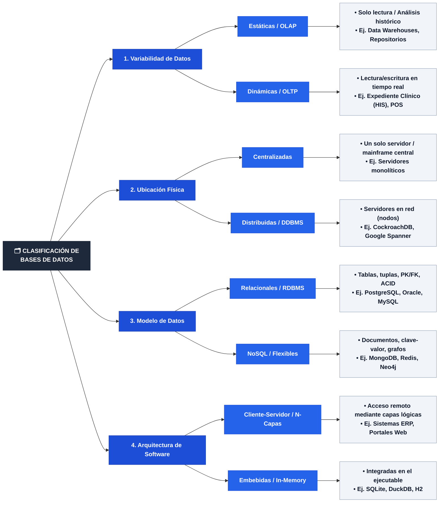
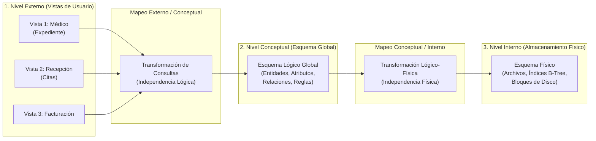
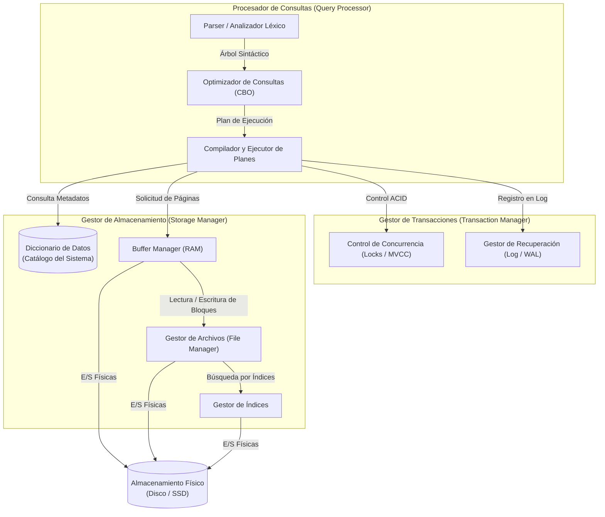

# 📘 Tarea 1.2: Clasificación de las Bases de Datos y Arquitecturas ANSI/SPARC y SGBD

---

## 👤 Datos de Identificación

- **Nombre:** Sheyla Estefania Moncada Guel
- **Matricula:** I24050388
- **Maestro:** Ruben Riojas
- **Asignatura:** Fundamentos de Bases de Datos
- **Unidad:** [Unidad 1 — Introducción a las Bases de Datos](../)

---

## 📝 Descripción

En esta actividad se estudia la taxonomía de las bases de datos y la arquitectura estandarizada de los motores de bases de datos:
1. **Clasificación de las Bases de Datos:** Cuadro sinóptico estructurado bajo cuatro criterios: *Variabilidad de Datos* (Estáticas/OLAP vs. Dinámicas/OLTP), *Ubicación Física* (Centralizadas vs. Distribuidas/DDBMS), *Modelo de Datos* (Relacionales/RDBMS vs. NoSQL/Flexibles) y *Arquitectura de Software* (Cliente-Servidor/N-Capas vs. Embebidas/In-Memory).
2. **Arquitectura de Tres Niveles (ANSI/SPARC):** Análisis del Nivel Externo (Vistas de Usuario), Nivel Conceptual (Esquema Global) y Nivel Interno/Físico, explicando los mapeos que garantizan la **Independencia Lógica y Física de los Datos**.
3. **Arquitectura Funcional Interna del SGBD:** Desglose de subsistemas clave: *Procesador de Consultas* (Parser, Optimizador CBO, Ejecutor), *Gestor de Almacenamiento* (Buffer Manager, File Manager, Gestor de Índices), *Gestor de Transacciones* (Control de Concurrencia Locks/MVCC y Recuperación WAL) y *Diccionario de Datos* (Catálogo del Sistema).

---

## 📊 Visualización de Gráficos

### 1. Cuadro Sinóptico de Clasificación de Bases de Datos (Mermaid.js)

### 2. Arquitectura de Tres Niveles (ANSI/SPARC) e Independencia de Datos

### 3. Arquitectura Funcional Interna de un SGBD

## Referencias Bibliográficas
* Connolly, T. M., & Begg, C. E. (2015). Database systems: A practical approach to design, 
implementation, and management (6th ed.). Pearson. 
* Date, C. J. (2004). An introduction to database systems (8th ed.). Addison-Wesley. 
* Elmasri, R., & Navathe, S. B. (2017). Fundamentals of database systems (7th ed.). Pearson. 
* Silberschatz, A., Korth, H. F., & Sudarshan, S. (2020). Database system concepts (7th ed.). 
McGraw-Hill. 
---

## 📦 Entregable

- 📄 **Archivo PDF de la Actividad:** [`Tarea_1.2.pdf`](./Tarea_1.2.pdf)
- 🎥 **Video Explicativo en YouTube:** [Ver video en YouTube](https://youtu.be/ui6-MONH-tc)

