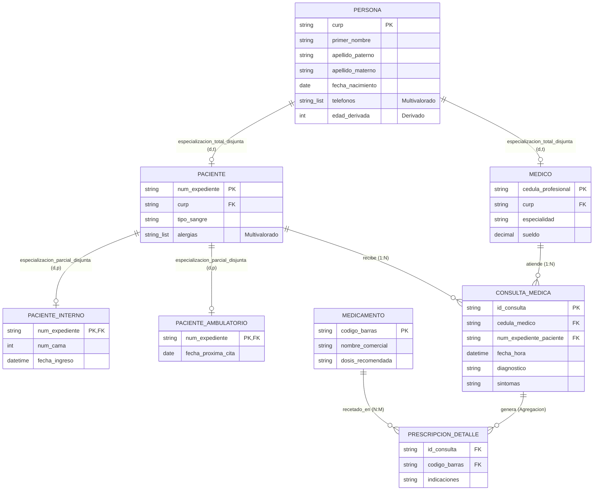

# 📗 Tarea 2.1: Diseño Conceptual E-R / E-RE del Sistema de Información Hospitalaria (HIS)

---

## 👤 Datos de Identificación

- **Nombre:** Sheyla Estefania Moncada Guel
- **Matricula:** I24050388
- **Maestro:** Ruben Riojas
- **Asignatura:** Fundamentos de Bases de Datos
- **Unidad:** [Unidad 2 — Diseño Conceptual (Modelo E-R, E-RE y UML)](../)

---

## 📝 Descripción

En esta actividad se desarrolla el diseño conceptual completo para un **Sistema de Información Hospitalaria (HIS)** empleando el **Modelo Entidad-Relación Extendido (E-RE)**:
1. **Reglas de Negocio Formales (`RN-01` a `RN-10`):** Definición de restricciones institucionales de identificación única (`CURP`, `Cédula Profesional`, `Número de Expediente`), multivaloración (`Teléfonos`, `Alergias`), atributos derivados (`edad`) y control de prescripción de medicamentos.
2. **Jerarquías de Especialización / Generalización (E-RE):**
   - `Persona` $\rightarrow$ `{Médico, Paciente}`: **Especialización Disjunta y Total (`d, t`)**.
   - `Paciente` $\rightarrow$ `{Paciente_Interno, Paciente_Ambulatorio}`: **Especialización Disjunta y Parcial (`d, p`)**.
3. **Agregación:** Abstracción del evento de `Atención Médica` (`Médico` + `Paciente` + `Consulta_Médica`) para vincular la prescripción `N:M` de `Medicamento` a través de `PRESCRIPCION_DETALLE`.

---

## 📊 Visualización de Gráficos

### 1. Diagrama Formal Entidad-Relación Extendido (E-RE) del Sistema Hospitalario

### 2. Identificación y Clasificación de Entidades y Atributos

| Entidad | Atributo Clave (PK) | Atributos Compuestos / Derivados | Atributos Multivalorados / Simples |
| :--- | :--- | :--- | :--- |
| **Persona (Superclase)** | `curp` | `nombre` (`primer_nombre`, `ap_paterno`, `ap_materno`), `edad` `[Derivado]` | `telefonos` `{Multivalorado}`, `fecha_nacimiento` |
| **Médico (Subclase)** | `cedula_profesional` | — | `especialidad`, `sueldo` |
| **Paciente (Subclase)** | `num_expediente` | — | `tipo_sangre`, `alergias` `{Multivalorado}` |
| **Paciente_Interno** | `num_expediente (FK)` | — | `num_cama`, `fecha_ingreso` |
| **Consulta_Médica** | `id_consulta` | — | `fecha_hora`, `diagnostico`, `sintomas` |

### 3. Relaciones, Cardinalidades y Restricciones de Participación

| Relación | Entidades Involucradas | Cardinalidad | Participación | Descripción Técnica |
| :--- | :--- | :---: | :---: | :--- |
| **Realiza** | `Médico` : `Consulta_Médica` | `1 : N` | Médico `(0,N)` - Consulta `(1,1)` | Un médico realiza `N` consultas; una consulta exige `1` médico responsable. |
| **Recibe** | `Paciente` : `Consulta_Médica` | `1 : N` | Paciente `(0,N)` - Consulta `(1,1)` | Un paciente recibe `N` consultas; una consulta pertenece a `1` solo paciente. |
| **Prescribe** | `Atención_Médica (Agregación)` : `Medicamento` | `N : M` | Atención `(0,N)` - Medicamento `(0,M)` | Una atención médica prescribe `N` medicamentos; un medicamento se prescribe en `M` atenciones. |

---

## 📦 Entregable

- 📄 **Archivo PDF de la Actividad:** [`Tarea_2.1.pdf`](./Tarea_2.1.pdf)
- 🎥 **Video Explicativo en YouTube:** [Ver video en YouTube](https://youtu.be/O1hbUj7mWUI)

