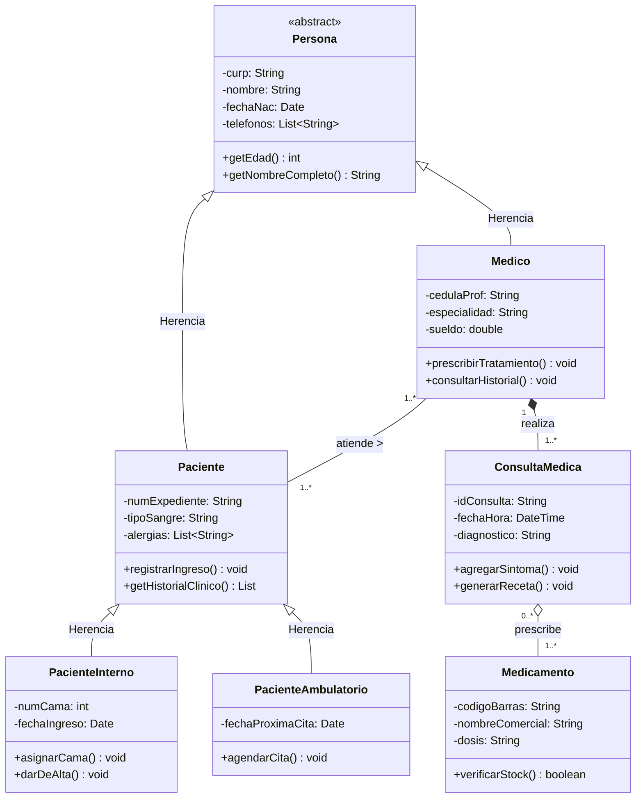

# 📗 Tarea 2.2: Transición Paradigmática de E-R a Diagrama de Clases UML

---

## 👤 Datos de Identificación

- **Nombre:** Sheyla Estefania Moncada Guel
- **Matricula:** I24050388
- **Maestro:** Ruben Riojas
- **Asignatura:** Fundamentos de Bases de Datos
- **Unidad:** [Unidad 2 — Diseño Conceptual (Modelo E-R, E-RE y UML)](../)

---

## 📝 Descripción

En esta actividad se realiza el mapeo formal entre el modelo conceptual **Entidad-Relación Extendido (E-RE)** del Sistema Hospitalario y el **Diagrama de Clases UML** bajo el Paradigma Orientado a Objetos (POO):
1. **Correspondencia de Constructos:** Transformación de la superclase `Persona` en una clase abstracta `<<abstract>>`, encapsulamiento de atributos con visibilidad privada (`-`), conversión del atributo derivado `edad` en el método público `+getEdad(): int`, y representación de relaciones mediante asociaciones, multiplicidades y composición.
2. **Diagrama de Clases UML del Sistema Hospitalario:** Modelado de estado y comportamiento de las clases `Persona`, `Medico`, `Paciente`, `PacienteInterno`, `PacienteAmbulatorio`, `ConsultaMedica` y `Medicamento`.
3. **Impacto para POO y ORM:** Análisis de estrategias de persistencia y herencia en mapeadores objeto-relacionales (Hibernate, JPA, Entity Framework).

---

## 📊 Visualización de Gráficos

### 1. Diagrama de Clases UML del Sistema Hospitalario (Mermaid.js)

### 2. Tabla Comparativa Detallada: Modelo E-R vs. Notación UML

| Concepto | Modelo Entidad-Relación (E-R / E-RE) | Notación UML (Diagrama de Clases) | Análisis para POO / BD |
| :--- | :--- | :--- | :--- |
| **Unidad Estructural** | Entidad / Conjunto de Entidades | Clase (Instanciable o Abstracta) | Pasa de ser una tabla relacional a una clase con estado y comportamiento. |
| **Propiedades** | Atributos (Claves, Simples, Compuestos) | Atributos / Campos (`- private`, `+ public`) | Permite encubrir el estado interno mediante encapsulamiento. |
| **Atributos Calculados** | Atributo Derivado `[Círculo Punteado]` | Método u Operación (`+ getEdad()`) | Elimina redundancia física en BD recalculando en memoria. |
| **Relación de Datos** | Relación / Rombo (`1:1`, `1:N`, `N:M`) | Asociación, Agregación, Composición | Define navegación entre objetos en código y claves foráneas en BD. |
| **Cardinalidad** | Min/Máx (e.g., `(1,1)`, `(0,N)`) | Multiplicidad (e.g., `1`, `0..*`, `1..*`) | Determina el uso de listas/colecciones en atributos de clase. |
| **Especialización** | Jerarquía ISA / Círculo (`d,t` / `d,p`) | Generalización / Herencia (Triángulo) | Habilita el polimorfismo y la reutilización de código en el dominio. |

## Referencias Bibliográficas
* Ambler, S. W. (2003). Agile Database Techniques: Effective Strategies for the Agile Software 
Developer. John Wiley & Sons. 
* Connolly, T., & Begg, C. (2015). Sistemas de bases de datos: Un enfoque práctico para diseño, 
implementación y gestión (5.ª ed.). Pearson Educación. 
* Fowler, M. (2004). UML Distilled: A Brief Guide to the Standard Object Modeling Language (3rd 
ed.). Addison-Wesley Professional. 
* Object Management Group. (2017). Unified Modeling Language (OMG UML) Specification (Version 
2.5.1).
---

## 📦 Entregable

- 📄 **Archivo PDF de la Actividad:** [`Tarea_2.2.pdf`](./Tarea_2.2.pdf)
- 🎥 **Video Explicativo en YouTube:** [Ver video en YouTube](https://youtu.be/Zm-oGz7hNDE)

