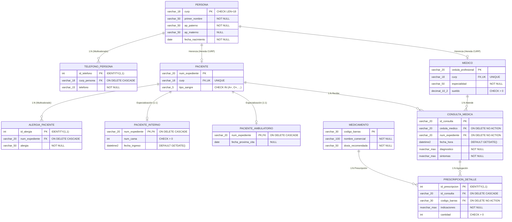

# 📙 Tarea 3.1: Componentes Formales del Modelo Relacional y Mapeo Lógico HIS

---

## 👤 Datos de Identificación

- **Nombre:** Sheyla Estefania Moncada Guel
- **Matricula:** I24050388
- **Maestro:** Ruben Riojas
- **Asignatura:** Fundamentos de Bases de Datos
- **Unidad:** [Unidad 3 — Modelo Relacional e Implementación Física DDL](../)

---

## 📝 Descripción

En esta actividad se fundamenta matemáticamente el **Modelo Relacional** propuesto por E. F. Codd (1970) y se aplica el algoritmo formal de transformación sobre el diseño E-RE del Sistema de Información Hospitalaria (HIS):
1. **Elementos Matemáticos y Claves:** Definición de Dominio ($D$), Atributo ($A$), Tupla ($t$), Relación ($R \subseteq D_1 \times D_2 \times \dots \times D_n$) y taxonomía de claves (`CK`, `PK`, `AK`, `FK`).
2. **Restricciones de Integridad Relacional:** Especificación de Integridad de Entidad (`PRIMARY KEY NOT NULL`), Integridad Referencial (`FOREIGN KEY` con `CASCADE`/`RESTRICT`), Integridad de Dominio (`CHECK`) y Reglas de Negocio.
3. **Mapeo Riguroso del Caso Hospitalario (Reglas 1 a 6):** Transformación de superclases/subclases, atributos multivalorados y agregación `N:M` en un esquema relacional de 10 tablas implementado en [`Act_3.1.sql`](./Act_3.1.sql).

---

## 📊 Visualización de Gráficos

### 1. Diagrama del Esquema Relacional Físico/Lógico del Sistema Hospitalario (Mermaid.js)

### 2. Restricciones de Integridad en el Modelo Relacional

| Categoría de Integridad | Definición Regla Formal | Mecanismo de Implementación SQL / HIS |
| :--- | :--- | :--- |
| **Integridad de Entidad** | Ningún atributo de la Clave Primaria (`PK`) puede aceptar valores nulos (`NULL`). | `PRIMARY KEY` en cada tabla (ej. `CURP`, `Cédula`). |
| **Integridad Referencial** | Todo valor de una Clave Foránea (`FK`) debe existir en la `PK` referenciada o ser nulo. | `FOREIGN KEY REFERENCES` con `ON DELETE / UPDATE CASCADE / RESTRICT`. |
| **Integridad de Dominio** | Todos los valores de un atributo deben pertenecer al dominio definido. | `CHECK` constraints, `NOT NULL`, tipos de datos precisos. |
| **Reglas de Negocio** | Condiciones semánticas específicas impuestas por el entorno clínico. | `Triggers`, `CHECK` complejas (`sueldo > 0`, `tipo_sangre`). |

### 3. Mapeo Riguroso del Caso Hospitalario (HIS)

| Tabla Relacional | Atributos / Columnas | Claves (PK / FK) | Regla de Mapeo Aplicada |
| :--- | :--- | :--- | :--- |
| `PERSONA` | `curp`, `primer_nombre`, `ap_paterno`, `ap_materno`, `fecha_nacimiento` | **PK:** `curp` | Regla 1: Superclase Aplanada |
| `TELEFONO_PERSONA` | `id_telefono`, `curp_persona`, `telefono` | **PK:** `id_telefono` \| **FK:** `curp_persona` $\rightarrow$ `PERSONA` | Regla 2: Atributo Multivalorado |
| `MEDICO` | `cedula_profesional`, `curp`, `especialidad`, `sueldo` | **PK:** `cedula_profesional` \| **FK:** `curp` $\rightarrow$ `PERSONA (UQ)` | Regla 5: Subclase Heredada |
| `PACIENTE` | `num_expediente`, `curp`, `tipo_sangre` | **PK:** `num_expediente` \| **FK:** `curp` $\rightarrow$ `PERSONA (UQ)` | Regla 5: Subclase Heredada |
| `ALERGIA_PACIENTE` | `id_alergia`, `num_expediente`, `alergia` | **PK:** `id_alergia` \| **FK:** `num_expediente` $\rightarrow$ `PACIENTE` | Regla 2: Atributo Multivalorado |
| `PACIENTE_INTERNO` | `num_expediente`, `num_cama`, `fecha_ingreso` | **PK/FK:** `num_expediente` $\rightarrow$ `PACIENTE` | Regla 5: Subclase Especializada |
| `PACIENTE_AMBULATORIO` | `num_expediente`, `fecha_proxima_cita` | **PK/FK:** `num_expediente` $\rightarrow$ `PACIENTE` | Regla 5: Subclase Especializada |
| `CONSULTA_MEDICA` | `id_consulta`, `cedula_medico`, `num_expediente`, `fecha_hora`, `diagnostico`, `sintomas` | **PK:** `id_consulta` \| **FK1:** `cedula_medico` \| **FK2:** `num_expediente` | Regla 3: Propagación `1:N` |
| `MEDICAMENTO` | `codigo_barras`, `nombre_comercial`, `dosis_recomendada` | **PK:** `codigo_barras` | Regla 1: Entidad Fuerte |
| `PRESCRIPCION_DETALLE` | `id_prescripcion`, `id_consulta`, `codigo_barras`, `indicaciones`, `cantidad` | **PK:** `id_prescripcion` \| **FK1:** `id_consulta` \| **FK2:** `codigo_barras` | Regla 6: Agregación `N:M` |

## Referencias Bibliográficas
* Codd, E. F. (1970). A relational model of data for large shared data banks. Communications of 
the ACM, 13(6), 377-387. 
* Date, C. J. (2004). An introduction to database systems (8th ed.). Addison-Wesley. 
* Elmasri, R., & Navathe, S. B. (2017). Fundamentals of database systems (7th ed.). Pearson. 
* Silberschatz, A., Korth, H. F., & Sudarshan, S. (2020). Database system concepts (7th ed.). 
McGraw-Hill. 
---

## 📦 Entregable

- 📄 **Archivo PDF de la Actividad:** [`Tarea_3.1.pdf`](./Tarea_3.1.pdf)
- 💻 **Script SQL DDL Ejecutable:** [`Act_3.1.sql`](./Act_3.1.sql)
- 🎥 **Video Explicativo en YouTube:** [Ver video en YouTube](https://youtu.be/2Uxp1l8Yt1Q)

