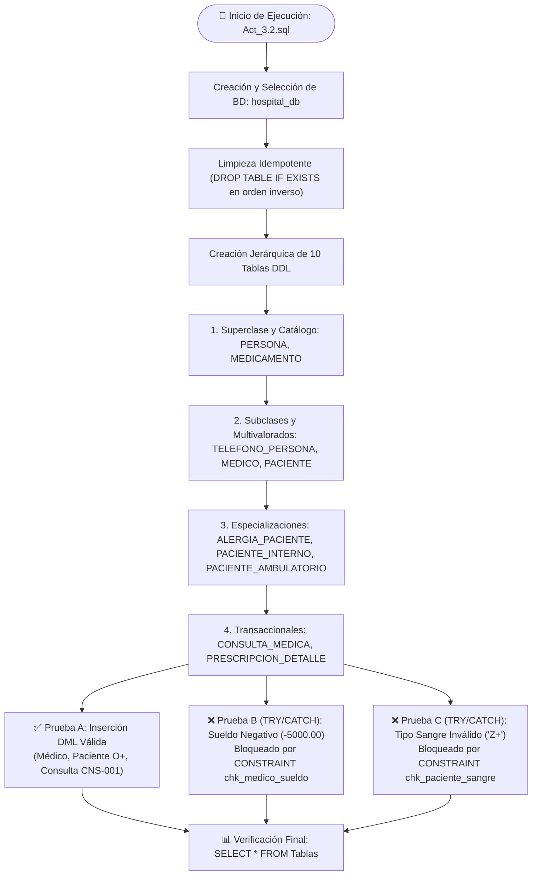

# 📙 Tarea 3.2: Implementación Física en SGBD y Pruebas de Validación DML

---

## 👤 Datos de Identificación

- **Nombre:** Sheyla Estefania Moncada Guel
- **Matricula:** I24050388
- **Maestro:** Ruben Riojas
- **Asignatura:** Fundamentos de Bases de Datos
- **Unidad:** [Unidad 3 — Modelo Relacional e Implementación Física DDL](../)

---

## 📝 Descripción

En esta actividad se lleva a cabo la implementación física y validación del esquema relacional del **Sistema de Información Hospitalaria (`hospital_db`)** mediante el Lenguaje de Definición de Datos (LDD/DDL) y pruebas de integridad con el Lenguaje de Manipulación de Datos (LMD/DML):
1. **Estrategia de Tipos de Datos y Mapeo Físico:** Selección justificada de tipos físicos (`VARCHAR(18)`, `DECIMAL(10,2)`, `DATE`, `DATETIME2`/`TIMESTAMP`, `NVARCHAR(MAX)`/`TEXT`).
2. **Políticas de Cascadas y Restricciones:** Configuración de `ON DELETE CASCADE` en entidades débiles/multivaloradas y `ON DELETE NO ACTION` / `RESTRICT` en entidades maestras (`MEDICO`, `PACIENTE`, `MEDICAMENTO`).
3. **Pruebas de Validación DML (`Act_3.2.sql`):** Inserción de datos semilla válidos y pruebas controladas con bloques `BEGIN TRY ... BEGIN CATCH` para comprobar el rechazo automático ante sueldos negativos (`sueldo = -5000.00`) y tipos de sangre inválidos (`tipo_sangre = 'Z+'`).

---

## 📊 Visualización de Gráficos

### 1. Flujo de Ejecución DDL y Validación de Restricciones en el SGBD (Mermaid.js)

### 2. Estrategia de Tipos de Datos y Mapeo Físico en SQL

| Tipo de Dato Lógico | Tipo de Dato Físico (SQL) | Justificación Técnica y Dominio |
| :--- | :--- | :--- |
| **Identificadores Únicos (`CURP`, `Cédula`)** | `VARCHAR(18)` / `VARCHAR(20)` | Cadenas de longitud fija o acotada con restricciones sintácticas estrictas mediante `CHECK`. |
| **Nombres y Descripciones Cortas** | `VARCHAR(50)` / `VARCHAR(100)` | Cadenas variables optimizadas para almacenamiento sin desperdicio de espacio físico. |
| **Textos Extensos (`Diagnóstico`, `Síntomas`)** | `TEXT` / `NVARCHAR(MAX)` | Campos sin límite rígido de caracteres para almacenar resúmenes clínicos detallados. |
| **Fechas y Marcas Temporales** | `DATE` / `TIMESTAMP` (`DATETIME2`) | Registros de precisión cronológica para nacimientos, citas y fechas/horas exactas de atención. |
| **Moneda / Sueldos y Cantidades** | `DECIMAL(10,2)` / `INT` / `IDENTITY` | Precisión decimal exacta para evitar redondeos numéricos en salarios e identificadores autoincrementables. |

---

## 📦 Entregable

- 📄 **Archivo PDF de la Actividad:** [`Tarea_3.2.pdf`](./Tarea_3.2.pdf)
- 💻 **Script SQL con Pruebas DML:** [`Act_3.2.sql`](./Act_3.2.sql)
- 🎥 **Video Explicativo en YouTube:** [Ver video en YouTube](https://youtu.be/rEiKP-lVJgM)

