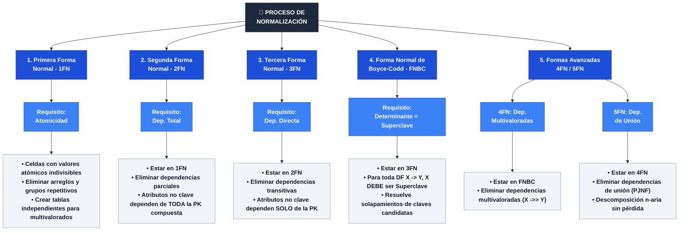

# 📕 Tarea 4.1: Concepto Formal de Normalización, Dependencias Funcionales y Formas Normales (1FN a 5FN)

---

## 👤 Datos de Identificación

- **Nombre:** Sheyla Estefania Moncada Guel
- **Matricula:** I24050388
- **Maestro:** Ruben Riojas
- **Asignatura:** Fundamentos de Bases de Datos
- **Unidad:** [Unidad 4 — Normalización de Bases de Datos](../)

---

## 📝 Descripción

En esta actividad se analizan los fundamentos matemáticos de la **Teoría de Normalización** para purificar esquemas relacionales mediante descomposición sin pérdida (*lossless-join decomposition*):
1. **Dependencias Funcionales ($X \rightarrow Y$):** Clasificación formal de dependencias Funcionales Totales/Completas, Parciales (violación de `2FN`), Transitivas (violación de `3FN`), Multivaloradas ($X \twoheadrightarrow Y$, base de `4FN`) y de Unión (*Join Dependency*, base de `5FN / PJNF`).
2. **Anomalías Clásicas de Diseño en Esquemas No Normalizados:** Evaluación técnica de las anomalías de Inserción, Borrado y Modificación sobre la tabla universal `REGISTRO_HOSPITALARIO_DESNORMALIZADO`.
3. **Mapa Conceptual Sintético de las Formas Normales (`1FN` a `5FN`):** Reglas escalonadas desde la atomicidad hasta la eliminación de dependencias de unión.

---

## 📊 Visualización de Gráficos

### 1. Mapa Conceptual Sintético de las Formas Normales (1FN a 5FN) en Mermaid.js

### 2. Tabla de Anomalías Operativas en el Sistema Hospitalario (HIS)

| Tipo de Anomalía | Manifestación en el Sistema Hospitalario (HIS) | Impacto Técnico y Operativo |
| :--- | :--- | :--- |
| **Anomalía de Inserción** | No se puede registrar un nuevo medicamento si no se le asocia de inmediato la consulta de un paciente. | Bloqueo de catálogos y obligatoriedad de datos ficticios o nulos. |
| **Anomalía de Borrado** | Al dar de baja el expediente de un paciente dado de alta, se elimina el registro histórico del médico tratante. | Pérdida no deseada de metadatos clínicos e institucionales. |
| **Anomalía de Modificación** | Si cambia el sueldo de un médico, debe actualizarse en 500 consultas históricas. Un fallo parcial genera inconsistencia. | Corrupción de integridad y duplicidad contradictoria de la verdad. |

## Referencias Bibliográficas
* Codd, E. F. (1970). A relational model of data for large shared data banks. Communications of 
the ACM, 13(6), 377-387. 
* Connolly, T. M., & Begg, C. E. (2015). Database systems: A practical approach to design, 
implementation, and management (6th ed.). Pearson Education. 
* Date, C. J. (2004). An introduction to database systems (8th ed.). Addison-Wesley. 
* Elmasri, R., & Navathe, S. B. (2017). Fundamentals of database systems (7th ed.). Pearson. 
* Silberschatz, A., Korth, H. F., & Sudarshan, S. (2020). Database system concepts (7th ed.). 
McGraw-Hill.
---

## 📦 Entregable

- 📄 **Archivo PDF de la Actividad:** [`Tarea_4.1.pdf`](./Tarea_4.1.pdf)
- 🎥 **Video Explicativo en YouTube:** [Ver video en YouTube](https://youtu.be/RoamPY7YxBU)

