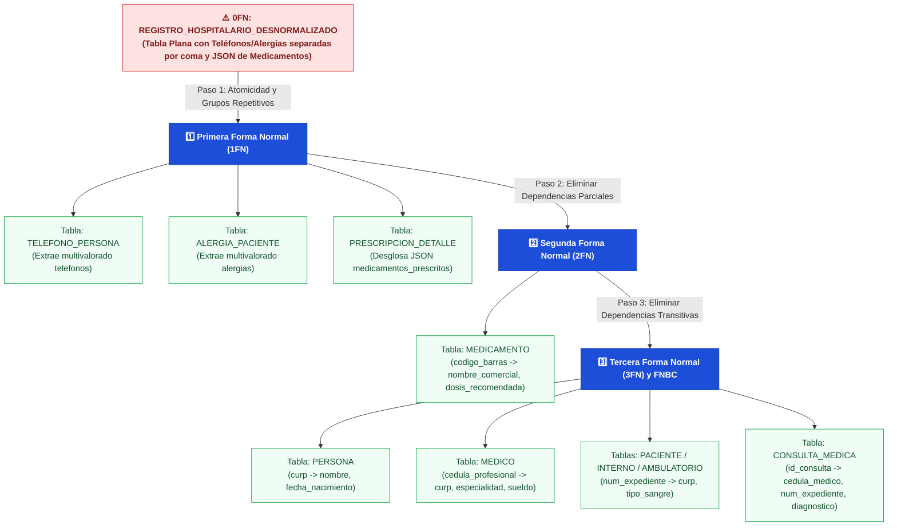

# 📕 Tarea 4.2: Normalización Paso a Paso del Sistema Hospitalario (0FN a 3FN / FNBC)

---

## 👤 Datos de Identificación

- **Nombre:** Sheyla Estefania Moncada Guel
- **Matricula:** I24050388
- **Maestro:** Ruben Riojas
- **Asignatura:** Fundamentos de Bases de Datos
- **Unidad:** [Unidad 4 — Normalización de Bases de Datos](../)

---

## 📝 Descripción

En esta actividad práctica se documenta y ejecuta en SQL ([`Act_4.2.sql`](./Act_4.2.sql)) el proceso de normalización paso a paso del Sistema de Información Hospitalaria (HIS), partiendo de una tabla universal desnormalizada (`0FN`) hasta alcanzar la **Tercera Forma Normal (`3FN`)** y la **Forma Normal de Boyce-Codd (`FNBC`)**:
1. **Estado Desnormalizado (`0FN`):** Análisis de la tabla plana `REGISTRO_HOSPITALARIO_DESNORMALIZADO`, la cual mezcla atributos del paciente, médico, consulta, cadenas multivaloradas (`telefonos_paciente`, `alergias_paciente`) y un grupo repetitivo en formato JSON (`medicamentos_prescritos`).
2. **Transición a `1FN`:** Garantía de atomicidad extrayendo `TELEFONO_PERSONA`, `ALERGIA_PACIENTE` y desglosando el arreglo JSON en la tabla asociativa `PRESCRIPCION_DETALLE`.
3. **Transición a `2FN`:** Eliminación de dependencias parciales sobre la clave compuesta `(id_consulta, codigo_barras)`, separando el catálogo `MEDICAMENTO` (`nombre_comercial`, `dosis_recomendada`).
4. **Transición a `3FN` y `FNBC`:** Eliminación de dependencias transitivas aislando `PERSONA`, `MEDICO`, `PACIENTE` (y sus especializaciones) y `CONSULTA_MEDICA`.

---

## 📊 Visualización de Gráficos

### 1. Pipeline de Descomposición Sin Pérdida: de 0FN a 3FN / FNBC (Mermaid.js)

### 2. Resumen de Transformación por Forma Normal

| Etapa | Anomalía / Dependencia Detectada | Acción Correctiva en el Esquema SQL (`Act_4.2.sql`) |
| :--- | :--- | :--- |
| **0FN $\rightarrow$ 1FN** | Listas de valores en `telefonos_paciente`, `alergias_paciente` y arreglo JSON en `medicamentos_prescritos`. | Creación de tablas `TELEFONO_PERSONA`, `ALERGIA_PACIENTE` y `PRESCRIPCION_DETALLE` con celdas 100% atómicas. |
| **1FN $\rightarrow$ 2FN** | Dependencia parcial: `(id_consulta, codigo_barras) -> nombre_med, dosis_rec` (dependen solo de `codigo_barras`). | Creación del catálogo independiente `MEDICAMENTO (codigo_barras PK, nombre_comercial, dosis_recomendada)`. |
| **2FN $\rightarrow$ 3FN / FNBC** | Dependencias transitivas: `id_consulta -> cedula_medico -> nombre_medico, especialidad, sueldo` y `num_expediente -> curp_paciente -> nombre_paciente`. | Descomposición en entidades independientes `PERSONA`, `MEDICO`, `PACIENTE`, `PACIENTE_INTERNO`, `PACIENTE_AMBULATORIO` y `CONSULTA_MEDICA`. |

## Referencias Bibliográficas
* Codd, E. F. (1970). A relational model of data for large shared data banks. Communications of 
the ACM, 13(6), 377–387. 
* Connolly, T. M., & Begg, C. E. (2015). Database systems: A practical approach to design, 
implementation, and management (6th ed.). Pearson. 
* Elmasri, R., & Navathe, S. B. (2017). Fundamentals of database systems (7th ed.). Pearson. 
* Silberschatz, A., Korth, H. F., & Sudarshan, S. (2020). Database system concepts (7th ed.). 
McGraw-Hill. 
---

## 📦 Entregable

- 📄 **Archivo PDF de la Actividad:** [`Tarea_4.2.pdf`](./Tarea_4.2.pdf)
- 💻 **Script SQL (0FN vs 3FN):** [`Act_4.2.sql`](./Act_4.2.sql)
- 🎥 **Video Explicativo en YouTube:** [Ver video en YouTube](https://youtu.be/1h1aQib35Mo)

