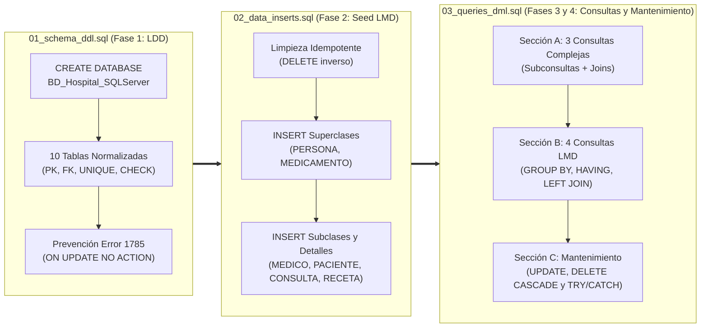

# 📓 Tarea 6.2: Implementación de Script DDL, Carga de Datos y Consultas DML

---

## 👤 Datos de Identificación

- **Nombre:** Sheyla Estefania Moncada Guel
- **Matricula:** I24050388
- **Maestro:** Ruben Riojas
- **Asignatura:** Fundamentos de Bases de Datos
- **Unidad:** [Unidad 6 — Introducción al Lenguaje SQL (LDD y LMD)](../)
- **Motor SGBD:** Microsoft SQL Server Express 2019/2022 (`T-SQL` / `SSMS`) — Base de Datos: `BD_Hospital_SQLServer`

---

## 📝 Descripción

En esta actividad integradora se desarrolla e implementa la arquitectura física y transaccional completa del **Sistema de Información Hospitalaria (HIS)** en Microsoft SQL Server (`T-SQL`), organizada modularmente en una estructura de **3 scripts ejecutables** ([`01_schema_ddl.sql`](./01_schema_ddl.sql), [`02_data_inserts.sql`](./02_data_inserts.sql) y [`03_queries_dml.sql`](./03_queries_dml.sql)):

1. **`01_schema_ddl.sql` — Lenguaje de Definición de Datos (LDD / DDL):** Creación limpia e idempotente de la base de datos `BD_Hospital_SQLServer` y sus 10 tablas (`PERSONA`, `TELEFONO_PERSONA`, `MEDICO`, `PACIENTE`, `ALERGIA_PACIENTE`, `PACIENTE_INTERNO`, `PACIENTE_AMBULATORIO`, `CONSULTA_MEDICA`, `MEDICAMENTO`, `PRESCRIPCION_DETALLE`) con restricciones `PRIMARY KEY`, `FOREIGN KEY`, `UNIQUE`, `CHECK`, `DEFAULT` y configuración anti-ciclos (`ON UPDATE NO ACTION`) para prevenir el Error 1785 de SQL Server.
2. **`02_data_inserts.sql` — Lenguaje de Manipulación de Datos (LMD - Poblado Semilla):** Limpieza previa en orden inverso e inserción controlada de registros de prueba (*seed data*) respetando la jerarquía de integridad referencial.
3. **`03_queries_dml.sql` — Consultas Analíticas y Mantenimiento Referencial:**
   - **Sección A:** 3 consultas complejas con selección ($\sigma$), proyecciones anidadas (subconsultas derivadas y en cláusula `IN` / escalar) y múltiples reuniones (`INNER JOIN` y `LEFT OUTER JOIN`).
   - **Sección B:** Banco de consultas LMD con `WHERE`, `ORDER BY`, `GROUP BY`, `COUNT`, `AVG`, `MAX`, `MIN`, `HAVING` e `ISNULL`.
   - **Sección C:** Operaciones `UPDATE`, prueba de borrado en cascada (`ON DELETE CASCADE`) y comprobación de bloqueo referencial mediante bloque `BEGIN TRY ... BEGIN CATCH`.

---

## 🗂️ Estructura de Scripts del Directorio

```text
Unidad_6/Tarea_6.2/
├── README.md               # Documentación e instrucciones de clonación y ejecución en el SGBD
├── Tarea_6.2.pdf           # Reporte técnico completo de la actividad en formato PDF
├── 01_schema_ddl.sql       # Fase 1: Creación de BD, 10 tablas y restricciones (DDL / LDD)
├── 02_data_inserts.sql     # Fase 2: Carga de datos semilla de prueba (INSERT INTO / LMD)
└── 03_queries_dml.sql      # Fases 3 y 4: Consultas complejas SELECT y mantenimiento (UPDATE / DELETE)
```

---

## 🚀 Instrucciones para Clonar y Ejecutar en el SGBD

### 1. Requisitos Previos
- **Motor de Base de Datos:** Microsoft SQL Server (Express, Developer o Standard 2019 / 2022).
- **Cliente Gráfico (Recomendado):** SQL Server Management Studio (**SSMS**) o Azure Data Studio / VS Code con extensión `mssql`.
- **Git:** Para clonar el repositorio localmente (o descargar el `.zip` desde GitHub).

### 2. Clonar el Repositorio

Abre una terminal (`PowerShell`, `CMD` o `Git Bash`) y ejecuta los siguientes comandos:

```bash
# 1. Clonar el repositorio desde GitHub
git clone https://github.com/sheylanga/Bases_Datos.git

# 2. Acceder al directorio de los scripts de la Tarea 6.2
cd Bases_Datos/Unidad_6/Tarea_6.2
```

### 3. Ejecución Paso a Paso en el SGBD

Para garantizar la integridad referencial, los scripts deben ejecutarse en **orden numérico estricto** (`01` $\rightarrow$ `02` $\rightarrow$ `03`):

#### Opción A: Ejecución desde SQL Server Management Studio (SSMS)
1. Abre **SSMS** y conéctate a tu instancia local de SQL Server (ej. `localhost\SQLEXPRESS` o `.`).
2. Abre y ejecuta **`01_schema_ddl.sql`** (`Archivo > Abrir > Archivo...` y presiona **`F5`** o **Ejecutar**):
   - *Resultado esperado:* Se crea desde cero la base de datos `BD_Hospital_SQLServer` y sus 10 tablas sin errores de rutas múltiples de cascada.
3. Abre y ejecuta **`02_data_inserts.sql`** (presiona **`F5`**):
   - *Resultado esperado:* Se insertan los médicos, pacientes, teléfonos, alergias, internamientos, citas, consultas, medicamentos y prescripciones.
4. Abre y ejecuta **`03_queries_dml.sql`** (presiona **`F5`**):
   - *Resultado esperado:* En la pestaña **Results (Resultados)** se despliegan las tablas resultantes de las 7 consultas `SELECT`, y en la pestaña **Messages (Mensajes)** se confirma la actualización de sueldos, el borrado en cascada del expediente `EXP-2002` y el mensaje de captura del bloqueo referencial (`>> BLOQUEO CORRECTO: The DELETE statement conflicted with the REFERENCE constraint "FK_CONS_MEDICO"`).

#### Opción B: Ejecución Rápida desde Terminal (`sqlcmd`)
Si prefieres ejecutar los 3 scripts directamente desde `PowerShell` o `CMD` usando la utilidad `sqlcmd`:

```powershell
sqlcmd -S localhost\SQLEXPRESS -E -i 01_schema_ddl.sql
sqlcmd -S localhost\SQLEXPRESS -E -i 02_data_inserts.sql
sqlcmd -S localhost\SQLEXPRESS -E -i 03_queries_dml.sql
```

---

## 📊 Visualización de Gráficos

### 1. Flujo de Ejecución Modular de los Scripts SQL (Mermaid.js)



### 2. Resumen del Banco de Consultas y Pruebas (`03_queries_dml.sql`)

| Sección / Operación | Cláusulas SQL Utilizadas | Objetivo Técnico en el Sistema Hospitalario (HIS) |
| :--- | :--- | :--- |
| **A.1 — Consulta Compleja 1** | Subconsulta derivada + `WHERE` + 5 `INNER JOIN` | Historial integral de recetas emitidas exclusivamente por la especialidad `Cardiologia`. |
| **A.2 — Consulta Compleja 2** | `INNER JOIN` + Subconsulta `WHERE ... IN (SELECT ...)` | Pacientes con alergias registradas que recibieron recetas de alto volumen (`cantidad > 20`). |
| **A.3 — Consulta Compleja 3** | Subconsulta escalar `AVG(sueldo)` + `LEFT OUTER JOIN` + `ISNULL` | Médicos con sueldo superior al promedio hospitalario, conservando médicos sin consultas (`SIN CONSULTAS`). |
| **B.1 — Filtrado Cronológico** | `INNER JOIN`, `WHERE`, `ORDER BY ASC` | Obtener expedientes y tipo de sangre de pacientes nacidos antes del año `2000`. |
| **B.2 — Estadísticas Salariales** | `GROUP BY`, `COUNT`, `AVG`, `MAX`, `MIN` | Calcular total de médicos y sueldos promedio, máximo y mínimo por especialidad. |
| **B.3 — Filtro de Agregados** | `GROUP BY`, `HAVING AVG(sueldo) > 43000` | Filtrar especialidades médicas con sueldo promedio superior a `\$43,000`. |
| **B.4 — Demanda de Fármacos** | `LEFT OUTER JOIN`, `COUNT`, `ISNULL(SUM(...), 0)` | Listar **todos** los medicamentos del catálogo (incluyendo no recetados) y sus unidades totales. |
| **C.1 — Mantenimiento `UPDATE`** | `UPDATE ... SET ... WHERE` | Incremento salarial del `10%` en `Cardiologia` y actualización de diagnóstico clínico. |
| **C.2 — Borrado en Cascada** | `DELETE FROM PACIENTE` (`ON DELETE CASCADE`) | Al eliminar `EXP-2002`, se purgan automáticamente sus filas en `ALERGIA_PACIENTE` y `PACIENTE_INTERNO`. |
| **C.3 — Bloqueo Referencial** | `BEGIN TRY ... DELETE ... END TRY BEGIN CATCH` | Impide borrar al médico `CED-1001` por tener consultas activas y captura el mensaje de error `FK_CONS_MEDICO`. |

---

## 📦 Entregable

- 📄 **Archivo PDF de la Actividad:** [`Tarea_6.2.pdf`](./Tarea_6.2.pdf)
- 💻 **Script 01 — Esquema DDL:** [`01_schema_ddl.sql`](./01_schema_ddl.sql)
- 💻 **Script 02 — Datos Semilla DML:** [`02_data_inserts.sql`](./02_data_inserts.sql)
- 💻 **Script 03 — Consultas y Mantenimiento DML:** [`03_queries_dml.sql`](./03_queries_dml.sql)
- 🎥 **Video Explicativo en YouTube:** [Ver video en YouTube](https://youtu.be/yYAfo22buhA)

[](./Tarea_6.2.pdf)
[](./01_schema_ddl.sql)
[](./02_data_inserts.sql)
[](./03_queries_dml.sql)
[](https://youtu.be/yYAfo22buhA)
